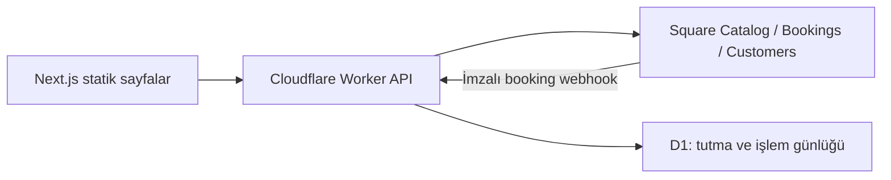

# Waterloo Barber Shop — mantık, sıfırdan kurulum ve işletim

Bu belge mevcut kodun tek bakım/kurulum rehberidir. Son düzenleme: 2 Kasım 2026. Eski ödeme taslakları, tasarım planları ve dağınık kurulum belgeleri bunun yerine kaldırılmıştır.

## 1. Sistemin parçaları

- `/`: Statik tanıtım sitesi; hizmetler, üyelikler, galeri, adres ve iletişim.
- `/book/`: Daytime Services ve VIP After Hours arasında seçim.
- `/book/daytime/`: Yalnızca Daytime Square kategorisi ile rezervasyon.
- `/book/vip/`: Yalnızca VIP After Hours Square kategorisi ile rezervasyon.
- Eski `/booking-demo/` adresi Cloudflare `_redirects` ve yerel sunucuda kalıcı olarak `/book/` adresine yönlenir. Demo etiketi kaldırılmıştır.
- `/api/booking/*`: Cloudflare Worker sunucu API'si. Square tokenı yalnız burada kullanılır.
- **Square:** Katalog, fiyat, süre, personel ataması, çalışma saatleri, gerçek müşteri ve randevu kayıtlarının kaynağıdır.
- **D1:** Sitenin 10 dakikalık tutmaları, çakışma/işlem kilitleri, tekrar deneme kayıtları, hız sınırı ve webhook tekrarlarını tutar.
- **Ödeme işletmede:** Kart, Apple Pay, Google Pay ve Payments API yoktur. Ücretsiz hizmetler ücretsiz kalır.



### Ana sayfa ve booking arasındaki fark

Ana sayfanın hizmet/üyelik fiyat metinleri ve gösterilen açılış saatleri React bileşenlerinde **editoryal, statik** içeriktir. Square senkronizasyonu `/book/daytime/` ve `/book/vip/` içindeki hizmet/fiyat/müsaitlik için geçerlidir. Ana sayfa metnini değiştirmek için ilgili bileşeni düzenleyip build al.

Ana sayfadaki tüm “Book an appointment” bağlantıları aynı sekmede `/book/` seçim sayfasına gider. Square’ın barındırdığı rezervasyon sayfasına yönlendirme yoktur. Kategori adresleri `src/lib/booking-routes.ts` dosyasındadır. Ortak `BookingFlow` kategori prop’unu sayfadan alır; kategori form içinde değiştirilemez. Sayfa ve API aynı Square kategori/saat politikasını kullanır. Eski oturumdaki tutma/rezervasyon başka kategoriye aitse o kategorinin adresinde devam bağlantısı gösterilir; yanlış kategoride servis seçilmez ve tutma süresi uzatılmaz.

Üyelik butonları e-posta uygulamasını açar; üyelik tahsilatı veya otomatik indirim uygulamaz. Galeri görselleri tam boy yeni sekmede açılır. Harita OpenStreetMap iframe'i, yol tarifi Google Maps bağlantısıdır. Mobil menü ve yukarı çık düğmesi client bileşenleridir. Yerleşik mesaj/e-posta gönderme veya analytics servisi yoktur.

## 2. Dosyalar ve sorumlulukları

| Dosya/dizin | Sorumluluk |
| --- | --- |
| `src/app/page.tsx`, `components/` | Ana sayfa ve editoryal içerik |
| `src/app/layout.tsx`, `globals.css` | Metadata, Playfair/Inter fontları, marka stilleri |
| `src/app/book/page.tsx`, `daytime/page.tsx`, `vip/page.tsx` | Seçim sayfası ve kategoriye sabitlenmiş rezervasyon adresleri |
| `src/lib/booking-routes.ts` | Site içi CTA adresi ve kategori başlıkları/bağlantıları |
| `src/app/book/BookingFrame.tsx`, `booking.css` | Ortak marka başlığı, sayfa çerçevesi ve mobil/masaüstü stilleri |
| `src/app/book/BookingFlow.tsx` | Hizmet → saat → bilgiler → inceleme → sonuç |
| `src/app/book/BookingPolicy.tsx` | Square iptal politikasının görünümü |
| `src/lib/booking-policy.mjs` | Frontend ve API'nin ortak kategori/saat/personel/tutma kuralları |
| `server/booking-catalog.mjs` | Square hizmetlerini doğrulama ve fiyat çözümleme |
| `server/square-booking.mjs` | API yönlendirme, Square çağrı izin listesi, canlı müsaitlik |
| `server/holds.mjs` | Sunucu zamanıyla 10 dakikalık, sahiplik doğrulamalı tutma |
| `server/reservations.mjs` | İdempotent müşteri/randevu oluşturma ve kurtarma |
| `server/booking-summary.mjs` | İptal politikası sürümü, Square vergi hesabı |
| `server/booking-crypto.mjs` | AES-GCM şifreleme ve HMAC referans doğrulaması |
| `server/checkout-store.mjs` | D1/SQLite sorguları ve şema; eski ad uyumluluk için korunur |
| `server/local-checkout-store.mjs` | Yerel özel SQLite veritabanı |
| `server/cloudflare-entry.mjs` | Worker giriş noktası, Origin/host/hız sınırı ve webhook |
| `cloudflare/checkout-schema.sql` | Yeni D1 için tam şema |
| `cloudflare/migrations/0001-booking-holds.sql` | Eski D1'e tutma tablosu ekleyen migrasyon |
| `scripts/` | Env kurulumu/kontrolü, yerel sunucu, build/audit/runtime testi/ZIP |
| `tests/` | Katalog, saat sınırları, eşzamanlılık, kurtarma ve güvenlik testleri |
| `public/` | Yayınlanan görseller, marka logosu, ikonlar ve booking CSP |

Cloudflare **Advanced mode** kullanılır: `out/_worker.js`. Ayrı `functions/` adaptörü gerekmez. Normal statik dosyalar `ASSETS.fetch` ile sunulur. `.env`, kaynak kodu, yerel DB, Worker kaynak dosyası ve source map yolları halka servis edilmez.

## 3. Square katalog ve fiyat mantığı

Config, Square Catalog'dan `ITEM,CATEGORY` kayıtlarını ve sayfalı bookable personel listesini okur. Hizmetin lokasyona açık, silinmemiş, `APPOINTMENTS_SERVICE` ve `available_for_booking` olması; süresinin pozitif tam dakika ve fiyatının sabit GBP olması gerekir.

İki kategori listelenir; hizmet listeleri kodda sabit değildir. Doğru Square kategorisine eklenen uygun hizmet yenilemede gelir. Hem Daytime hem VIP kategorisindeki bir hizmet, hangi saat kuralının uygulanacağı belirsiz olduğu için reddedilir.

### Fiyat

1. Varsa `location_overrides.price_money`, yoksa varyasyonun `price_money` alanı baz alınır.
2. `price_description` doluysa içindeki **tek, açık GBP tutarı** Square booking sayfasındaki gibi teklif fiyatı olarak kullanılır.
3. Örnek: Baz £41, açıklama `Haircuts %10 OFF - £37` → müşteri £37 görür. Site yüzde indirim hesaplamaz.
4. Açıklama yoksa sayısal fiyat kullanılır. Birden fazla tutar, “from”, depozito veya fiyat aralığı güvenli biçimde engellenir.
5. VIP fiyatı **VIP hizmetinin kendi Square fiyatıdır**; Daytime fiyatı ikiyle çarpılmaz.
6. Vergi bağlıysa salt hesaplama yapan `Orders CalculateOrder` kullanılır; order/payment oluşturulmaz. Hatalı hesapta tahmini tutar gösterilmez.

**Square'da fiyatı değiştirirken fiyat açıklamasını da güncelle.** Açıklamada eski £37 bırakılırsa o tutar esas alınmaya devam eder. Fiyat/süre/varyasyon sürümü son onayda yeniden doğrulanır; değişiklik varsa müşteri yeniden incelemelidir.

İptal penceresi, metin, no-show ücreti ve iptal izni Square business booking profilinden okunur. Politika hash ile sürümlenir; onayda güncel sürümün kabulü gerekir. Eksik özel politika metni uydurulmaz; no-show ücreti burada tahsil edilmez.

## 4. Saat ve personel kuralları

Saat dilimi `Europe/London`; GMT/BST otomatik uygulanır. Çalışma günleri, açılış/kapanış saatleri, molalar, izinler ve mevcut randevular **Square canlı müsaitliğinden** gelir. Eski 19.15/19.20 kapanışlarını saklayan veya saat üreten yerel takvim yoktur.

| Kural | Güncel davranış | Değişiklik yeri |
| --- | --- | --- |
| Daytime | Başlangıç 20.00'den önce; tam 20.00 ve sonrası kapalı | `DAYTIME_POLICY` |
| Daytime bitiş | Square müsait gösteriyorsa 20.00'den geç bitebilir | `requireFinishByCutoff: false` |
| VIP | Başlangıç 20.00 ve sonrası; en geç gece yarısında bitiş | `VIP_POLICY` |
| VIP ön bildirim | Başlangıca en az 90 dakika; onayda da kontrol | `VIP_POLICY.minimumLeadMinutes` |
| VIP personel | Yalnız Tatar/Beyhan; ayrıca Square hizmet ataması gerekli | `VIP_STAFF_IDS` |
| Haftalık günler | Square belirler; kodda hafta içi/yedi gün sınırı yok | Square staff bookable hours |
| Brazilian Blow-Dry | Daytime için en erken 18.00 | `BRAZILIAN_*` sabitleri |
| Tutma | Yenilenmeyen 10 dakika | `HOLD_DURATION_MS` |

Kod ayarlarının hepsi `src/lib/booking-policy.mjs` içindedir. Square'da gündüz kapanışı 19.15'ten 17.15'e çekilirse sonraki sorgu bunu takip eder. Gece 22.00'de açılıyorsa VIP 20.00/21.00 üretmez. Daytime 19.45 başlangıç/20.25 bitiş ancak Square döndürürse mümkündür.

Yarın Daytime'ın en geç 20.00'de **bitmesini** istersen:

```js
export const DAYTIME_POLICY = { cutoffMinutes: 20 * 60, requireFinishByCutoff: true };
```

`false` başlangıç sınırıdır; `true` bitiş sınırı da ekler. 18.00 alt sınırı olan 150 dakikalık Brazilian hizmeti bitiş sınırı açılırsa Daytime'da uygun saat bulamayabilir. Kod kuralı değişiklikleri test/build ister; Square saat/fiyat/gün değişiklikleri için sayfayı veya saatleri yenilemek yeterlidir.

### Mevcut Square kimlikleri

Bunlar gizli token değildir. Yeni Square hesabı/lokasyonu kurulursa değişebilirler.

| Kayıt | Kimlik / ayar |
| --- | --- |
| Lokasyon | `LM3CKN1Y1RJ0P` — env |
| Daytime kategorisi | `5WANQKJL7SXJ3G6UTWJSPEQH` — policy |
| VIP kategorisi | `V7A55PRHQFS5ZGUPWX5GDX57` — policy |
| Suleyman Tatar / Tatar | `TMwTM4USQOtky2wH` — VIP kişi listesi |
| Beyhan Kaya / Bayhan | `TMjP0H-6qwXwl7ie` — VIP kişi listesi |
| Daytime Classic varyasyonu | `TKQNC5W2UA3KODCVAO62QVZC` — API varsayılanı |
| Brazilian varyasyonu | `26OAPY6WANNEFAZ5UMNTDTYT` — 18.00 sınırı |

Kategori adı değişirse görünür başlık Square'dan güncellenir. Kategoriyi silip yeniden oluşturursan policy kimliğini güncelle. Yeni hizmet için kod eşleştirmesi gerekmez; kategori, lokasyon, fiyat, süre ve uzman ataması yeterlidir. Yeni hesapta ana sayfa/booking içindeki Square fallback URL'lerini de güncelle.

## 5. Rezervasyonun tüm yolculuğu

1. **Config:** Hizmet, kategori, personel ve politika yüklenir. Secret/ödeme SDK ayarı tarayıcıya gitmez.
2. **Müsaitlik:** Tarih/hizmet/uzman için Square sorgulanır. Yanlış personel/hizmet/lokasyon, kopya, süre uyuşmazlığı ve kategori saatleri elenir. D1 aktif tutma/işlem çakışmaları gizlenir.
3. **Saat seçimi:** “Continue to your details”, aktif booking modunda D1'e 10 dakikalık tutma oluşturur. Square takvimine geçici randevu yazılmaz.
4. **Bilgiler:** Ad, soyad, e-posta, ülke kodlu telefon; isteğe bağlı gerçek doğum tarihi ve en çok 1000 karakter not. Paylaşım onayı gerekir.
5. **İnceleme:** Saat, fiyat ve politika tekrar okunur. Müşteri/randevu oluşturulmaz. Due today £0, due at appointment güncel teklif tutarıdır.
6. **Hazırlık:** Aktif tutma, müşteri alanları, politika sürümü/onayı ve fiyat doğrulanır. Şifreli `DRAFT` yazılır; Square'da hâlâ müşteri/randevu oluşturulmaz.
7. **Açık son onay:** Tutma atomik olarak işlem kilidine geçirilir. Müsaitlik ve Square takvim çakışması kontrol edilir. Tam e-posta+telefon eşleşmesi varsa müşteri kullanılır; yoksa idempotent oluşturulur.
8. **Randevu:** Kalıcı idempotency key ve aynı kayıt kullanılır. Güncel varyasyon sürümü/süre/personel gönderilir. Satıcı notunda fiyatın işletmede ödeneceği ve online ödeme alınmadığı yazılır.
9. **Doğrulama:** Square randevusu tekrar okunup `ACCEPTED` olunca onay gösterilir ve işlem kilidi bırakılır. `PENDING` veya belirsiz sonuç başarı sayılmaz.

Yeni müşteri doğum tarihi verilmişse gönderilir. Mevcut doğum tarihi korunur; boşsa yalnız o alan güncellenebilir. Farklı verilen doğum tarihi notta belirtilir. Doğum günü/öğrenci/üyelik indirimi otomatik uygulanmaz.

### Tutma ve tarayıcı kapanması

Tutmanın sonu sunucuda sabittir. Yenilemek, sekmeyi kapatmak veya client saatini değiştirmek uzatmaz. Süresi geçmiş satır `expires_at` filtresiyle etkisizleşir; açılması için cron/tarayıcı gerekmez. Sayaç client'ta saniyede bir güncellenir, D1'e her saniye istek atılmaz. **Açık işlem kilidi** tutma dolunca bırakılmaz; yarım onayda çifte randevu engellenir.

Tarayıcı `sessionStorage` içinde yalnız referans kimliği/sahiplik tokenı tutar; ad/e-posta/telefon/doğum tarihi/not saklamaz. Yeni sekme veya farklı cihaz arasında otomatik kurtarma garantisi yoktur. Site tutması Square'ın hosted booking tutmasıyla ortak değildir; dış randevular onayda tekrar kontrol edilir.

## 6. İşlem durumları ve kurtarma

```text
DRAFT
  → RESERVATION_PRECHECK_PENDING
  → RESERVATION_CUSTOMER_PENDING
  → RESERVATION_CREATE_PENDING
  → RESERVATION_VERIFY_PENDING
  → COMPLETE

Bilinen başarısızlık → RESERVATION_CANCEL_PENDING → FAILED
```

İşlem başına 5 dakikalık DB lease ve çakışan aralıklar için atomik SQL kullanılır. Eşzamanlı iki tutmadan yalnız biri kazanır. Square yanıtı kaybolursa **aynı persisted body ve idempotency key** tekrar gönderilir; yeni referans üretilmez. Bilinen başarısızlıktan sonra yalnız bu işlemin oluşturduğu randevu gerekirse iptal edilir.

Kurtarma: açık sayfanın durum sorgusu, geri dönen müşterinin aynı referansı ve imzalı `booking.created`/`booking.updated` webhook'u. Yerelde ayrıca 30 saniyelik interval vardır. **Cloudflare yayında ayrı scheduled/cron Worker yoktur.** Tarayıcı onay sırasında kapanır ve webhook oluşmadan işlem yarıda kalırsa yalnız bu kurulumla belirli sürede otomatik kurtarma garantisi yoktur; aynı referansla durum kontrolü gerekir. Sonuç belirsizken yeni referansla tekrar rezervasyon yaptırma.

Süresi geçen tutma ve terminal işlem satırları için otomatik toplu silme/retention işi yoktur. Backup/silme politikası ayrıca planlanmalı; aktif işlem/kilitleri elle silerek düzeltme yapma.

Eski ödeme kayıtları silinmez, tahsilat/iptal/iade yeniden çalıştırılmaz; eski referans `NEEDS_ATTENTION` döner. Payment uçları 410, eski checkout status yalnız güvenli görüntülemedir. Bu küçük uyumluluk korumaları bilerek korunmuştur.

## 7. API uçları

POST istekleri JSON ve aynı `Origin` gerektirir. Gövde üst sınırı 8192 byte'dır.

| Metot / `/api/booking/…` | İşlev |
| --- | --- |
| `GET config` | Katalog, personel, politika, tarih aralığı ve mod |
| `POST availability` | Canlı Square müsaitliği, site kilitleri filtresi |
| `POST review` | Yeniden doğrulama; ödeme/randevu oluşturmaz |
| `POST hold/create` | Sahiplik doğrulamalı 10 dakikalık tutma |
| `POST hold/status` | Aynı bitiş zamanıyla tutma durumu |
| `POST hold/release` | Yalnız sahibinin aktif tutmasını bırakma |
| `POST reservation/prepare` | Şifreli taslak |
| `POST reservation/confirm` | Açık onayla Square rezervasyonu |
| `POST reservation/status` | Aynı işlemin durumu ve gerektiğinde kurtarma |
| `POST webhook` | Square imza doğrulaması ve olay kurtarması |
| `POST checkout/status` | Eski referansa salt okunur uyumluluk |
| Eski `checkout/prepare`, `checkout/commit`, `payments` | 410: ödeme yok |

API tarih aralığı bugün–60 gündür; Square'ın daha sıkı advance booking/lead-time kuralları da geçerlidir. Square en az bir saatlik sorgu penceresi istediği için geç VIP araması gerektiğinde genişletilir; dönen saatler gerçek alt sınıra göre tekrar filtrelenir.

## 8. Sıfırdan yerel kurulum

Gerekenler: **Node.js 24**, **pnpm 12.16.1**, Git; ZIP release için `zip`/`unzip`. macOS/Linux doğrulanmış ortamdır. `node:sqlite` nedeniyle eski Node 18 yönergesi geçersizdir. Font build'i `next/font/google` nedeniyle ilk kurulumda Google Fonts erişimi gerektirebilir.

Aşağıdaki `nvm` komutları nvm kurulu makineler içindir. Nvm kullanmıyorsan Node.js 24'ü kendi sürüm yöneticin/kurulumunla yükleyip aynı komutları atla.

```sh
git clone git@github.com:seventhlegend/the-barber-shop-waterloo.git
cd the-barber-shop-waterloo
nvm install 24
nvm use
npm install -g pnpm@12.16.1
pnpm install --frozen-lockfile
pnpm env:init
```

`env:init` yalnız `.env` yoksa örnekten oluşturur; özel dosya izinleriyle rastgele 64 hex karakterli recovery key yazar ve booking'i kapalı başlatır. Secret yazdırmaz, mevcut dosyanın üzerine yazmaz.

`.env` içine Square tokenı/lokasyonunu ekle. Mevcut canlı D1'le devam ediyorsan **yeni yerel anahtar yerine mevcut Cloudflare recovery Secret'ının aynısını güvenle kullan**. Eski kayıtlar yeni anahtarla açılamaz; yeni anahtar yalnız boş/yeni DB içindir.

```sh
pnpm env:check
pnpm book
```

`book` build alır, `http://localhost:3000/book/` üzerinde statik dosya + gerçek yerel API sunar. `BOOKING_ENABLED=false` iken Square katalog/müsaitlik incelenebilir; tutma/gerçek rezervasyon kapalıdır. `true` Production'da **gerçek müşteri/randevu oluşturur**; test için son Confirm düğmesine basma.

`pnpm dev` yalnız Next frontend geliştirmesidir; Square API sunucusunu başlatmaz. Değişikliği gerçek API ile görmek için `pnpm book` ile build al. `pnpm start`, `serve`, `book:serve` önceki `out/` çıktısını yerel API ile sunar; `.env` ve build gerekir. Port uyumluluk için korunan `BOOKING_DEMO_PORT` ile değişir. Eski `pnpm demo` / `demo:serve` komutları `book` / `book:serve` alias’larıdır.

Yerel veri `.booking-data/checkouts.sqlite`, fallback key `.booking-data/recovery-secret` içindedir. İkisi de Git/ZIP dışındadır. Mevcut işlemler için dizini veya `.env` anahtarını silme.

## 9. Square'ı sıfırdan hazırlama

1. Developer Console'da uygulama ve Production lokasyonunu seç. Server Access Token'ı yalnız `.env`/Cloudflare Secret kullan. Token doğru satıcının Catalog, Customers, Bookings ve gerektiğinde Orders Calculate erişimine sahip olmalı. OAuth kullanırsan kapsamları [Square Bookings API rehberinden](https://developer.squareup.com/docs/bookings-api/use-the-api) doğrula.
2. Appointments, online booking ve seller-level booking yazma açık olmalı. Kod `ACCEPT_ALL` ve `support_seller_level_writes` doğrular. Gerekli hesap/abonelik yetkisini Square'dan kontrol et; plan/fiyat varsayılmaz.
3. Daytime/VIP kategorilerini oluştur. Hizmetleri kategori, lokasyon ve uzmanlara ata; sabit GBP fiyat, tam dakika süre ve online booking izni tanımla.
4. Tatar/Beyhan'ı bookable yap, VIP hizmetlerine ata. Gün/gece aralıklarını staff bookable hours içinde yönet. `20:00–00:00` bitişi ertesi gün gece yarısıdır; gündüz aralarını koru.
5. Site VIP'de yalnız `VIP_STAFF_IDS` kişilerini kabul eder; yeni kişi eklemek bilinçli kod değişikliğidir.
6. İptal politikasını Square'da düzenle. Square tüketici hesabına giriş ve otomatik e-posta/SMS bu entegrasyonun işlevleri değildir.
7. Yeni hesap/lokasyonda Square kategori, servis, uzman ve lokasyon kimliklerini güncelle. Site içi rezervasyon adresleri `src/lib/booking-routes.ts` dosyasından yönetilir.

Square personel saatleri diğer online kanallarla ortaktır; sitedeki kategori filtresi Square'ın hosted booking sayfasını kısıtlamaz.

## 10. Cloudflare Pages + D1 sıfırdan kurulum

### A. Önce D1 ve tam şema

1. D1 veritabanı oluştur. İsim serbest; mevcut DB `barbershop-bookings`.
2. Yeni DB'nin **Console** bölümünde `cloudflare/checkout-schema.sql` dosyasının tamamını çalıştır.
3. `SELECT name FROM sqlite_schema WHERE type = 'table' ORDER BY name;` ile kontrol et.

| Tablo | İçerik |
| --- | --- |
| `checkouts` | Şifreli snapshot, phase, terminal flag, işlem lease'i |
| `checkout_slots` | İşlem sürerken korunan personel aralıkları |
| `booking_holds` | Şifreli tutma, sahiplik hash'i, süre ve durum |
| `booking_rate_limits` | Ham IP yerine hash'li dakika sayacı |
| `booking_webhook_events` | İşlenen Square olay kimlikleri |

Eski DB'de sadece `booking_holds` eksikse `cloudflare/migrations/0001-booking-holds.sql` çalıştır. Yalnız `CREATE IF NOT EXISTS` içerir; tekrar çalışabilir ve kayıtları değiştirmez.

**Önceki canlı arıza:** 2 Kasım 2026'da config çalışırken availability 500 dönüyordu; `booking_holds` eksikti. Kullanıcı onayıyla tablo/indeks eklendi, iki canlı hostta Daytime/VIP 200 ile doğrulandı. Mevcut DB'de migrasyon uygulanmıştır; yeni boş DB için tam şema şarttır. **ZIP otomatik migrasyon çalıştırmaz.**

### B. Pages binding ve runtime env

Production ve Preview ayarları ayrıdır. D1 resource binding adı **`CHECKOUT_DB`** olmalı; text env değildir. Kendi DB'ni seç. Git entegrasyonunda build `pnpm build`, çıktı `out`, Node sürümü 24'tür.

| İsim | Cloudflare türü | Değer |
| --- | --- | --- |
| `SQUARE_ACCESS_TOKEN` | Secret | Square server tokenı |
| `SQUARE_LOCATION_ID` | Variable | Lokasyon ID |
| `SQUARE_ENVIRONMENT` | Variable | `production` veya ayrı test verileriyle `sandbox` |
| `SQUARE_API_VERSION` | Variable | Varsayılan `2026-09-16` |
| `BOOKING_ENABLED` | Variable | Gerçek rezervasyon `true`, önizleme `false` |
| `CHECKOUT_RECOVERY_SECRET` | Secret | Yeni DB'de yeni kalıcı key; mevcut DB'de **eski key'in aynısı** |
| `BOOKING_ALLOWED_ORIGINS` | Variable | Örn. `https://waterloobarber.shop,https://thebarbershop.pages.dev` |
| `CHECKOUT_DB` | D1 resource binding | Yukarıdaki DB |
| `SQUARE_WEBHOOK_SIGNATURE_KEY` | Secret | Square endpoint Signature Key |
| `SQUARE_WEBHOOK_NOTIFICATION_URL` | Variable | Tam `https://waterloobarber.shop/api/booking/webhook` |

Origin değerlerinde son slash/path olmasın. Preview adresiyle testte o tam origin'i ve ilgili environment ayarlarını ekle; sınırsız wildcard kullanma. `.env` Cloudflare'a aktarılmaz. Binding/env değişiminden sonra yeni deployment gerekebilir; gerçek yayımlanan environment'ta doğrula.

Square Application ID, Sandbox payment credential'ları, Apple Pay doğrulama dosyası ve eski `SQUARE_VIP_VARIATION_MAP` gerekmez. `CHECKOUT_ENABLED` yalnız yeni booking flag yoksa eski fallback'tir; yeni kurulumda kullanma. Hiçbir bayrak online ödeme açmaz.

### C. Webhook

Square Developer Console → Production → Webhooks → Subscriptions endpoint'i:

```text
https://waterloobarber.shop/api/booking/webhook
```

Olaylar **`booking.created`, `booking.updated`**. Endpoint'in **Signature Key** değerini Cloudflare Secret'a kopyala; Application Secret veya Access Token değildir. Notification URL, protokol/host/path dahil Square'daki ile birebir aynı olmalı.

Ham gövde+tam URL için HMAC-SHA256 doğrulanır, event ID D1'de tekilleştirilir. İmzasız/değiştirilmiş/farklı URL istekleri reddedilir. Eksik ayarda 404 normaldir. Eski `payment.updated` yok sayılır. Abonelik kodla oluşturulmaz; webhook e-posta/SMS göndermez.

## 11. Build ve release komutları

| Komut | İşlev |
| --- | --- |
| `pnpm env:init` | Var olanı koruyarak ilk yerel `.env` ve key |
| `pnpm env:check` | Secret yazdırmadan isim/hazır olma kontrolü |
| `pnpm test` | Bütün repository testleri |
| `pnpm test:booking` / `test:cloudflare` | İlgili test grubu |
| `pnpm build` / `build:static` | Statik export + tek Worker + routes + audit |
| `pnpm build:website` | Yalnız statik frontend; booking API yok |
| `pnpm audit:build` | `out/` özel dosya/gerçek secret/ödeme kodu taraması |
| `pnpm test:cloudflare-runtime` | Son build'i gerçek workerd ve test D1 ile kontrol |
| `pnpm release:zip` | Env kontrolü, tüm testler, build, runtime testi, denetimli ZIP/SHA-256 |

Son `the-barber-shop-cloudflare-build-….zip` dosyasını Pages → Create deployment ile yükle. ZIP kökünde `index.html`, `_next/`, `book/` (daytime/vip dahil), `_redirects`, `_worker.js`, `_routes.json`, `_headers` vardır; dışta `out/` klasörü yoktur. `.sha256` yükleme dosyası değildir. `_routes.json` experimental uyarısı tek başına deploy hatası değildir; canlı API'yi doğrula.

Release ZIP'i geçici dizine açıp tekrar denetler. `.env`, token, DB, source map, ham server kaynakları veya online ödeme SDK/API kodu varsa paket reddedilir. Git push ve Pages deploy ayrı işlemdir; manual upload projesinde ZIP ayrıca yüklenir. Repo CLI tokenı veya otomatik yayın yetkisi içermez.

## 12. Güvenlik ve veriler

- Token client'a, `NEXT_PUBLIC_*` değişkenine veya log'a yazılmaz; API ham Square/Secret hatasını açığa çıkarmaz.
- Snapshot AES-GCM ile şifreli, referans sahipliği HMAC ile doğrulanır. Ham client tokenı DB'de tutulmaz; ele geçiren referansa erişebileceği için paylaşma.
- HTTPS, aynı Origin, izinli host, JSON/content length kontrolü vardır. Takvim 60, işlem/tutma 10, status 120 istek/dakika/IP-hash grubu ile sınırlandırılır; ham IP saklanmaz.
- Square çağrıları izin listesine bağlıdır; Payments API yoktur. Kart/para alanlarıyla eski ödeme isteği reddedilir.
- Booking CSP kendi kaynaklarına izin verir; ödeme iframe'i yoktur. Env/server/DB/source map dosyaları halka açılmaz.
- `.env`, `.booking-data/`, `.next/`, `out/`, `.wrangler/`, ZIP'ler Git dışıdır. Lockfile ve `.env.example` Git'te kalır.
- DB backup'ını ve **eşleşen recovery key'i** güvenle birlikte koru. Key kaybolursa DB dursa da şifreli kayıt açılamaz.

## 13. Sorun giderme

| Belirti | Kontrol / çözüm |
| --- | --- |
| Config geliyor, availability 500 | D1 `booking_holds`, `checkout_slots`, şema kontrolü. Eksik hold tablosuna migrasyon; tokenı değiştirme. Diğer DB hataları için Cloudflare Function logs. |
| Booking yapılandırılmamış / 503 | D1 binding, 32+ karakter recovery Secret, doğru Production/Preview env ve deployment kontrolü. |
| Square 502 | Token/lokasyon/hesap izinleri, Square durumu, hizmet bookable ayarı. Secret'ı rapora koyma. |
| 403 | Host origin listesinde mi, POST Origin aynı mı, HTTPS var mı? |
| 429 | Bir dakika bekle; hızlı tekrar sorgulamayı bırak. |
| VIP saati yok | Doğru kategori, Tatar/Beyhan ataması, gerçek Square gece müsaitliği, 90 dakika ve gece yarısı sınırı. |
| Yeni fiyat/saat yok | Yenile; açıklamada eski fiyat kalmış olabilir. Ana sayfa fiyat metni ayrıca statiktir. |
| Yerelde `/api` yok | Yalnız `pnpm dev` yerine `pnpm book`. |
| Eski tutma | Yenilemek uzatmaz. Yeni saat seç veya süre sonunu bekle. Gönderilmiş işlemde aynı referansla status kontrolü yap. |
| Key değişiminden sonra status çözülemiyor | Eski Secret'ı geri koy; DB'yi silme, yeni key ile açmaya çalışma. |
| Webhook 404/403 | İmza key'i, tam URL, event tipi ve DB binding. İmzasız isteğin reddi beklenir. |
| Belirsiz Confirm / PROCESSING | Referansı koru, status/webhook kurtarması kullan. Gerçek takvim kontrol edilmeden ikinci rezervasyon yapma. |

## 14. Yeniden kurulum sırası

1. Repo + Node/pnpm + frozen lockfile kurulumu.
2. Yeni env veya mevcut Secret'ların güvenli geri yüklenmesi.
3. Square hesap/lokasyon, kategori, hizmet, uzman atamaları ve çalışma saatleri.
4. Yeni D1 + **tam şema** veya mevcut DB + eksik migrasyon. Mevcut DB/key birlikte korunur.
5. Pages binding, runtime env, alan adı ve webhook aboneliği.
6. `pnpm release:zip`, ZIP yükleme veya Git tabanlı Pages build'i.
7. Canlı config/Daytime/VIP availability; UI'de 20.00 ayrımı, fiyat, süre, uzman kontrolü. Bunlar müşteri/randevu oluşturmaz.
8. Son Confirm testi yalnız işletmenin açıkça kabul ettiği randevu/verilerle yapılır; otomatik testler gerçek Square rezervasyonu/ödeme yapmaz.

Tamamen boş yeniden kurulumda eski geçmişi Git geri getirmez: Square hesabı, D1 backup'ı ve eşleşen Secret'lar ayrıca gerekir. Bu sistem Square'ın yerine ikinci bir takvim kurmaz; Square'ı kaynak, D1'i tutma ve güvenilir işlem günlüğü olarak kullanır.
